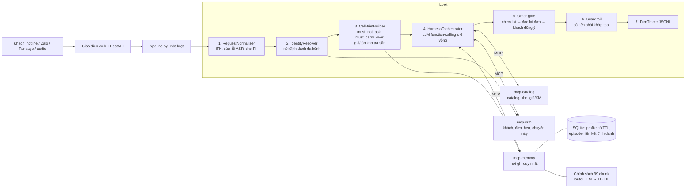

# Kiến trúc hệ thống

Mô tả đúng với mã hiện tại (chi tiết từng thành phần: [../docs/PIPELINE.md](../docs/PIPELINE.md); số liệu và quyết định: [../CHECKING.md](../CHECKING.md)).

## 1. Sơ đồ

## 2. Vòng lặp harness của một lượt

1. **Chuẩn hóa + che PII** — lời khách (text hoặc transcript ASR) được sửa lỗi nghe nhầm, đổi số nói bằng chữ (số tiền, SĐT, ngày) và che SĐT/địa chỉ/CCCD thành token. Chỉ text đã che mới đi vào LLM và trace; bảng token nằm trong bộ nhớ của lượt.
2. **Nhận diện** — SĐT / Zalo ID / FB ID → một mã khách (`mcp-crm`); khách cung cấp SĐT giữa chừng thì nối định danh các kênh và gộp bộ nhớ; SĐT dùng chung nhiều người thì hỏi xác nhận tên, không nạp thông tin nhạy cảm.
3. **Call Brief** — đọc hồ sơ + lịch sử, sinh danh sách *không được hỏi lại*, *phải mang sang*, câu mở đầu tiếp nối ("hôm 15/10 bên em có tư vấn…"), cảnh báo dữ liệu cũ; **code tra sẵn** giá/tồn kho/khuyến mãi hôm nay của sản phẩm đã tư vấn nên lượt đầu khỏi gọi tool.
4. **Điều phối** — LLM (function-calling) nhận prompt tĩnh + Call Brief và gọi tool qua MCP. Code sửa SKU sai (4 tầng), chèn ngày cuộc gọi, chống gọi lặp tool ghi, và tự mở bước đặt đơn bằng *bộ đọc lời khách* khi khách cam kết mua. Mỗi nhận định của LLM về ý định/đồng ý phải kèm **trích dẫn nguyên văn** từ lời khách, code kiểm chứng trích dẫn đó có thật.
5. **Order gate (luôn bật)** — trước `order.create`, code kiểm checklist (sản phẩm/biến thể, số lượng, tên và SĐT nhận, địa chỉ, thanh toán), đọc lại đơn đúng một lần và chỉ tạo đơn sau khi khách đồng ý rõ ràng ở lượt kế tiếp.
6. **Guardrail** — số tiền/phí/tồn kho trong lời agent phải có trong kết quả tool; chặn "đã lên đơn" khi chưa có tool; chặn lời cam kết không có căn cứ.
7. **Trace + ghi nhớ** — trace theo schema BTC (latency đo thật, `claims`, `questions`, `facts_used`); `commit_turn` chốt giao dịch bộ nhớ. Hết cuộc gọi (nút, timeout, chuyển máy) → episode + bộ trích slot khó (rào cản, ngân sách, giá đối thủ) bằng LLM.

Nguyên tắc: **LLM hiểu, code kiểm chứng và giữ an toàn** — không dùng regex vá từng câu nói của khách; mọi quyết định có hệ quả (tạo đơn, chuyển máy, nói số tiền) đều có chốt bằng code.

## 3. Bộ nhớ 4 tầng

| Tầng | Lưu | Cơ chế |
|---|---|---|
| Working | ngữ cảnh phiên đang diễn ra | xóa khi hết cuộc |
| Profile | sự thật bền về khách (tên, diện tích phòng, ngân sách, rào cản…) | TTL áp theo **ngày cuộc gọi**; khách đổi ý → bản cũ giữ ở trạng thái *superseded*, một bản *active*; có nguồn gốc `source_call/turn/channel` |
| Episodic | tóm tắt từng cuộc (sản phẩm, giá, rào cản, kết quả) | một episode / cuộc; đọc theo ngày gọi |
| Semantic | 99 chunk chính sách (chọn theo ngày hiệu lực) | **router LLM** chọn file + ngày mua + "ngoài tài liệu" → TF-IDF xếp hạng trong file đã chọn; router lỗi thì TF-IDF toàn bộ; chi phí router vào trace và trần chi phí |

## 4. Vì sao MCP, và vì sao *không* A2A

**MCP (3 server thật, `mcp_servers/`)** — đúng yêu cầu bảng C.3 (≥ 2 server, có `mcp-memory`):

- `mcp-memory` là **nơi ghi duy nhất**: chỉ tiến trình này giữ `MemoryService` và mở file SQLite, nên không có hai nơi cùng ghi một khách. Phân quyền theo *caller* ở phía server, mặc định từ chối (`config/mcp_permissions.json`): Call Brief và giao diện chỉ đọc; chỉ lõi điều phối được ghi; xóa khách chỉ caller `Operator`.
- `mcp-catalog` chỉ đọc (catalog, kho, giá/KM); `mcp-crm` giữ khách/đơn/hẹn/chuyển máy, tool ghi chỉ cho lõi điều phối.
- Lợi ích: ranh giới dữ liệu và quyền rõ ràng, nhật ký tool (`audit_log`) theo từng phiên, thay server mà không đổi lõi. Chi phí: một tiến trình/giao thức nữa (đã đo bằng `scripts/bench_memory.py`); có chế độ `inproc`/`local` cho test.

**A2A không được triển khai.** Bản đầu có lớp "A2A specialists"; hiện chỉ còn các module trong tiến trình (`src/agents/specialists.py`) làm *nhánh dự phòng khi mất LLM* và không gọi là giao thức A2A. Lý do: bài toán một agent + tool đủ giải quyết các kịch bản M1; thêm agent-to-agent làm tăng số lần gọi LLM và độ trễ mà không cải thiện chỉ số đo được. Nếu M2 cần tách tác tử (tư vấn / chính sách / đánh giá), điểm cắm đã sẵn ở `delegate_task`.

## 5. Các quyết định đáng chú ý

| Quyết định | Lý do |
|---|---|
| Order gate bằng code, luôn bật, mọi cấu hình | tránh tạo đơn khi khách chưa đồng ý; kéo theo TSR của kịch bản BTC cố định thấp (báo riêng, xem báo cáo) |
| Hiểu ý định bằng LLM + trích dẫn nguyên văn | tránh vá regex theo câu; code kiểm chứng trích dẫn |
| Tra sẵn giá/tồn kho/KM vào Call Brief | giảm số vòng gọi tool và TTFT của lượt đầu cuộc gọi lại |
| Guardrail đối chiếu số tiền với kết quả tool | chặn bịa giá/khuyến mãi |
| Nhánh dự phòng mất LLM không chọn sản phẩm | trước đây mặc định cứng một SKU; nay chưa biết sản phẩm thì hỏi lại |
| Timeout 20 s theo khoảng lặng + thử lại cả vòng stream | một lượt API đứng 68–128 s làm hỏng p95 (§ 11.94–11.95 trong CHECKING) |
| Che PII trước LLM/trace; API trả trace rút gọn đã che | chỉ số điện thoại/địa chỉ không rời khỏi tiến trình |

## 6. Giao diện và API

FastAPI (`api/`, một worker, giao diện web `ui/index.html` phục vụ cùng origin nên không cần CORS): phiên (`call_name`/`turn_num` do API cấp, mở phiên mới tự chốt phiên cũ), chat, Call Brief, dòng thời gian bộ nhớ, nhật ký tool, đơn hàng, ASR. Kho phiên nằm trong RAM; bộ nhớ khách nằm trong DB.
